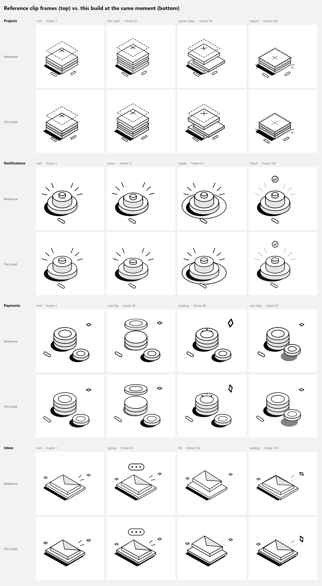

# Animated empty states

Four animated empty states — **Projects**, **Notifications**, **Payments** and **Inbox** — recreated in React, TypeScript and hand-built SVG from four short reference clips. Each illustration is layered SVG geometry animated part by part (no video, images, emoji or icon fonts).

Original design: [animated empty states by Divan Raj](https://x.com/desdivj/status/2119377174713229695). This is a study recreation; the original assets and animation curves were **not** available and were not recovered — everything here was redrawn and re-timed by measuring frames of the clips.



## Run it

```bash
npm install
npm run dev        # http://localhost:5183
npm run build      # type-check + production build into dist/
npm run preview    # serve dist/ on http://localhost:5184
npm run build:site # build, then pack this project into dist/empty-states-source.zip
```

## Getting the code from the showcase

Live at https://empty-states.pages.dev. Under each card a **Code** button opens a viewer with:

- **SVG**: a still of the illustration as standalone markup. The page styles the art with CSS classes and custom properties; the export resolves them and writes fill, stroke, width and dash as plain attributes, so it pastes into Figma or any HTML page. Code is in [`src/lib/svgExport.ts`](src/lib/svgExport.ts).
- **React + TypeScript**: the scene file and the helpers it imports (`parts.tsx`, `anim.ts`, `iso.ts`, `types.ts`), loaded as raw text on demand.

Both views have Copy and Download buttons. The page header links the whole project as a zip, which [`scripts/pack-source.mjs`](scripts/pack-source.mjs) writes at build time (`npm run build:site`). With a plain `npm run build` that link has nothing to serve.

Vite 6, React 18, TypeScript 5, plain CSS. Typeface: Geist Sans via `@fontsource/geist-sans`.

## Behaviour

- Each illustration starts playing when at least 40% of it is on screen, plays one pass (3.2–3.6 s), rests 1.4 s, and loops. It stops and resets when scrolled away.
- The illustration is a button: click, <kbd>Enter</kbd> or <kbd>Space</kbd> replays it from the start.
- `prefers-reduced-motion: reduce` shows a composed still pose per scene (e.g. the check badge for Notifications, the typing bubble for Inbox) and drops the replay control; the art is then exposed as an image with a text description.
- The action buttons (“Create Project”, …) are real, keyboard-focusable buttons, but nothing is wired behind them: pressing one only shows a short “Demo only” note in a polite live region.
- Phone chrome from the clips (status bar, nav buttons, photo backgrounds) is not reproduced; each state is a card in a responsive grid (4 across on wide screens, 1 column on phones, no horizontal overflow at 320 px).

## Tuning

| What | Where |
| --- | --- |
| Colours, stroke weights, dash pattern, type sizes, card/button shape, illustration width | CSS custom properties at the top of [`src/styles.css`](src/styles.css) |
| Pause between loops, autoplay visibility threshold | `PLAYER` in [`src/config.ts`](src/config.ts) |
| Geometry and timing of each scene | the constants and the `T` table at the top of each file in [`src/scenes/`](src/scenes) |

Timelines are keyframe tracks (`track([[frame, value, easing], …])`, see [`src/lib/anim.ts`](src/lib/anim.ts)) on a 60 fps clock, because the clips were measured frame by frame at 60 fps. Notifications, Payments and Inbox keep the clip's own 1-based frame numbers (`clipFrame`), so a key at `103` lines up with frame 103 extracted from the clip.

Debug helpers: `?frame=120` freezes every illustration on a frame, `?speed=0.25` slows playback, `?only=payments` shows one scene, and `window.__emptyStates.setFrame(n | null)` freezes/unfreezes at runtime.

## How it was matched

1. Frames were extracted from each clip with ffmpeg and cropped to the illustration (360 × 330 px), which is also the SVG `viewBox`, so reference pixels and SVG units are 1:1.
2. Shapes were measured from zoomed frames; motion was measured by tracing where outlines cross fixed pixel columns over time (top-panel lift, coin height, knob travel, ring radius, envelope lift, and so on).
3. [`scripts/capture.mjs`](scripts/capture.mjs) renders any frame of the build in headless Chrome at the same size; traced edges were compared against the clips and keys adjusted until most tracked edges sit within about 1–2 px and ±1 frame through the loop.
4. [`scripts/smoke.mjs`](scripts/smoke.mjs) checks autoplay, click/keyboard replay, reduced motion, the demo note, console errors and narrow-width overflow (`node scripts/smoke.mjs`; both scripts expect Chrome at the default Windows path or `CHROME_PATH`).

Clip → state: `01801bdb…mp4` Inbox, `b6fa1529…mp4` Payments, `d65401bd…mp4` Notifications, `1.mp4` Projects.

## Where the clips and the written brief disagree

The brief's prose and the clips describe different motion in places. The brief says the videos are the authority, so the build follows the clips:

- **Projects** — the clip doesn't simply drop a panel: the stack fans open, the middle panel slides out and back, then the panels collapse as the dashed “new project” outline falls onto the stack (squash, burst lines, pills knocked down), and the outline floats back up. The plus mark lies flat in the panel plane and turns a quarter turn during the motion.
- **Notifications** — the clip shows a push button on a round base (not a dome service bell), pressed three times with an expanding ripple ring after each press, then a check badge pops in and the rays dim.
- **Payments** — the top coin flips twice in the air and lands (squash, three sparkle dots, the diamond tumbles); the small coin hops toward the stack and back, and the stack does a little hop. There is no radial line burst in the clip.
- **Inbox** — the clip shows a closed envelope on a tray, a typing-indicator bubble, and the envelope lifting off the tray and landing; there is no card dropping into an open envelope, so no card/front-face layering was built.
- **Buttons** — the brief asks for black action buttons; the clips show a pale grey pill with a dark label and arrow, which is what's built. `--action-bg` / `--action-ink` switch it.

## Known differences from the reference

- **Not recovered:** source files, exact easing curves and the typeface. Timing is hand-keyed from measurements sampled every 1–2 frames; between samples the easing is a guess.
- **Typeface:** Geist Sans is a stand-in for the clips' grotesk; letterforms and widths differ slightly.
- **Coin flip** is drawn as a vertical squash of the coin (a triangle-wave scale), not a true 3D rotation, so the edge-on frames show a thin face rather than the coin's rim.
- **Diamond tumbles** (Payments, Inbox) are approximated with rotate + skew + scale; the reference's in-between shapes differ.
- **Plus mark** (Projects): the exact rotation profile mid-motion couldn't be read reliably from the clip; some in-between frames show it at a different angle.
- **Geometry:** Projects uses isometric projection with a slightly steeper pitch (0.507) to match; Inbox uses measured corner points because the reference's envelope and tray aren't exact isometric parallelograms. Notifications/Payments use measured ellipses. A few edges remain 2–3 px off, and stroke weights are uniform where the reference varies slightly.
- **Rays, ripple ring, sparks, motion lines:** colours and fades are matched by eye at a few sample points; the reference's subtle motion smearing on fast frames isn't reproduced.
- **Layout:** the phone screen was re-proportioned into a card; heading, illustration, copy and button keep the reference's order, colours and relative sizes (including the copy's slight indent) but not its exact spacing.
- **Trigger and loop:** the clips don't show what starts the animation; autoplay-in-view, the 1.4 s rest between loops and click/keyboard replay are this implementation's choices.
